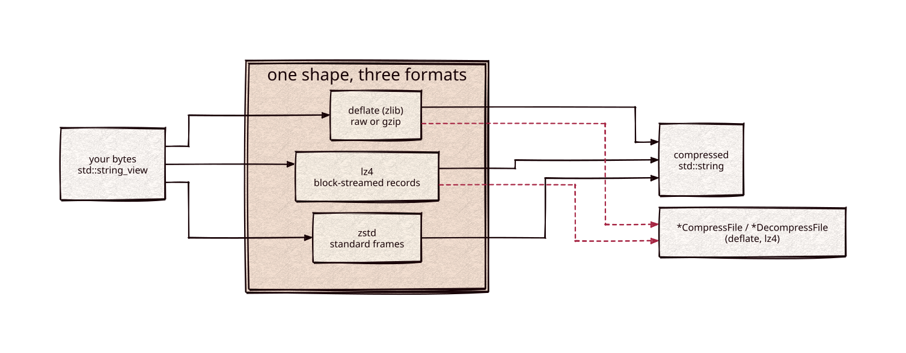

# compressors

Part of [Kronuz C++ Libraries](https://github.com/Kronuz/cpp-libraries), a collection of small, reusable C++ libraries.

[](https://github.com/Kronuz/compressors/actions/workflows/ci.yml)
[](LICENSE)


Compression for C++20 with three interchangeable backends, deflate (zlib), LZ4,
and Zstandard, behind one shape: `compress_zstd(bytes)`, and swap the name to
switch codecs. For storage and network layers that want a codec choice without
three different APIs.



## ✨ Highlights

- **One shape, three codecs.** `compress_<backend>` and `decompress_<backend>`
  take a `std::string_view` and return a `std::string`.
- **Block streaming.** Iterate the compressed output block by block, and reuse a
  compressor's buffers with `reset()`.
- **File descriptors.** deflate and LZ4 stream to and from fds with EINTR-safe
  I/O.
- **Safe on hostile input.** `decompress_zstd(bytes, max_size)` refuses frames
  that claim more than `max_size`.
- **Blocks into your buffer.** `compress_lz4_block` and `compress_zstd_into` (and
  their decoders, bounded by the exact size) write one block into a buffer you own,
  with per-thread contexts: no allocation per block.
- **Reproducible bytes.** `COMPRESSORS_ZSTD_PINNED` and `COMPRESSORS_LZ4_PINNED`
  build pinned releases, so output is byte-identical on every platform.
- **Finds or fetches its dependencies.** zlib from the system; LZ4 and zstd from
  the system or fetched.

## 📦 Installation

Requires a C++20 compiler, CMake 3.14 or newer, and zlib; LZ4 and zstd are used
from the system when found and fetched otherwise. On macOS, pass
`-DCMAKE_PREFIX_PATH="$(brew --prefix)"` so CMake finds Homebrew's packages. CI
builds it on Linux (x86_64, arm64), macOS (arm64, x86_64), and FreeBSD, plus
ASan, UBSan, and TSan builds.

```cmake
include(FetchContent)
FetchContent_Declare(compressors
  GIT_REPOSITORY https://github.com/Kronuz/compressors.git
  GIT_TAG        main)
FetchContent_MakeAvailable(compressors)

target_link_libraries(my_app PRIVATE compressors::compressors)
```

## 🚀 Quick start

```cpp
#include "compressor_zstd.h"
#include "compressor_lz4.h"

#include <cassert>
#include <string>

int main() {
	std::string payload(100'000, 'x');

	std::string packed = compress_zstd(payload);                  // or compress_lz4, compress_deflate
	assert(decompress_zstd(packed, payload.size()) == payload);   // bounded for untrusted input

	assert(decompress_lz4(compress_lz4(payload)) == payload);
}
```

[`examples/roundtrip.cc`](examples/roundtrip.cc) shows codec dispatch, block
streaming, and edge inputs.

## ⚡ Performance notes

- `compress_lz4` / `decompress_lz4` write the same bytes as the block-streaming classes but
  skip their machinery: no zero-filled 256 KB ring per call, no per-block string, no digest.
  The first 256 KB of a stream is contiguous in the classes' ring, so it is compressed from
  (decompressed into) the caller's buffer directly; past that the ring wraps, which changes
  what LZ4 sees as its dictionary, so the rest goes through a ring as before. On an Apple M-series
  host: 256 B compress 4x and decompress 20-50x faster, 1 MB random 1.4-1.6x and 3.4x, text 1.0-1.5x.
- `XXH32` keeps its four lanes in scalar registers on AArch64 (the compiler otherwise packs
  them into a NEON vector, whose longer multiply latency halves the speed). Same digests,
  upstream speed (about 12 GB/s).
- `cmake -DCOMPRESSORS_BENCH=ON` builds `bench/` (the XXH32 comparison fetches upstream xxHash,
  for the benchmark only).

## 🎯 When to use it

- ✅ Compressing records, pages, or messages in memory, with the codec chosen per
  use: zstd for ratio, LZ4 for speed, deflate for gzip interop.
- ❌ Reading `.zst` or `.lz4` files from other tools: the LZ4 backend uses its own
  record framing, and only zstd writes a standard frame.

## 📚 Documentation

- [docs/API.md](docs/API.md): the three backends and their formats, the interface,
  how dependencies are found, and the build options.
- [ARCHITECTURE.md](ARCHITECTURE.md): the CRTP block-streaming bases and the
  buffer and fd families.
- [AGENTS.md](AGENTS.md): repository map and conventions.

## 🛠️ Building and testing

```sh
cmake -B build -DCMAKE_PREFIX_PATH="$(brew --prefix)"   # the prefix path on macOS only
cmake --build build && ctest --test-dir build
```

## 🤝 Contributing

Issues and pull requests are welcome. Read [AGENTS.md](AGENTS.md) first. CI must
pass on every platform.

## 📄 License

MIT, Copyright (c) 2015-2019 Dubalu LLC. See [LICENSE](LICENSE). The vendored
`xxh32_stream.h` carries its own BSD 2-Clause license (Yann Collet). Extracted
from [Xapiand](https://github.com/Kronuz/Xapiand); the zstd backend is new.
